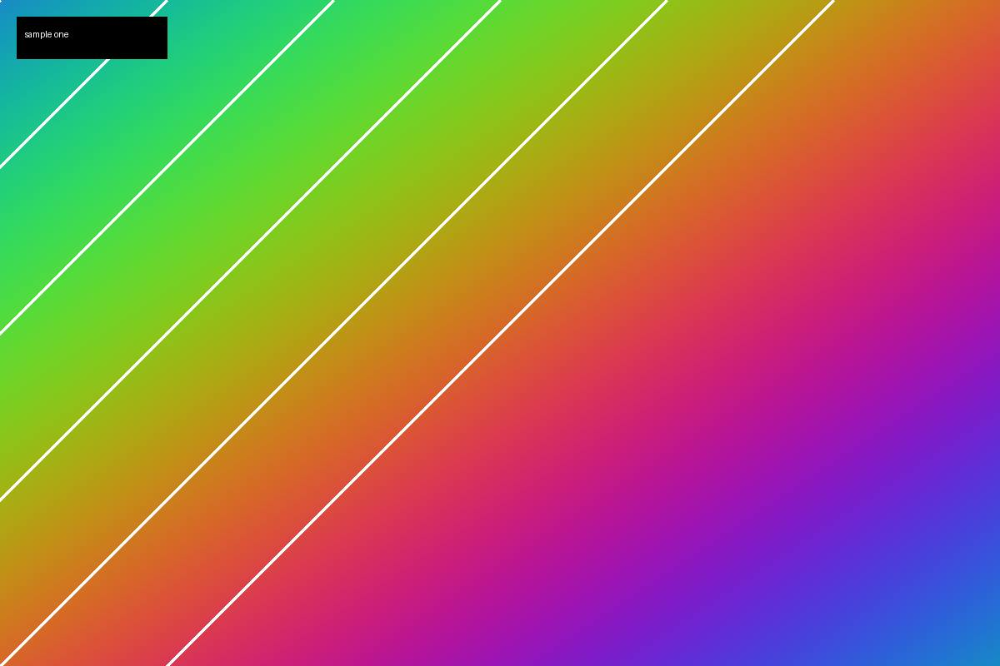

Nobody picks beige. Beige happens to a room the way weather happens to a weekend. You move into an apartment and the walls are already beige, the carpet is a slightly different beige, and the blinds are a third beige that doesn't match either of them.

This is a fixture post. It exists so that the home page has more than one entry, so that previous and next links have somewhere to go, and so that tags have more than one post to list.

The second paragraph is here to give the page some length. Long-form writing is the point of this blog, so every theme is judged on how it handles several screens of plain paragraphs, not just a headline and a picture.
